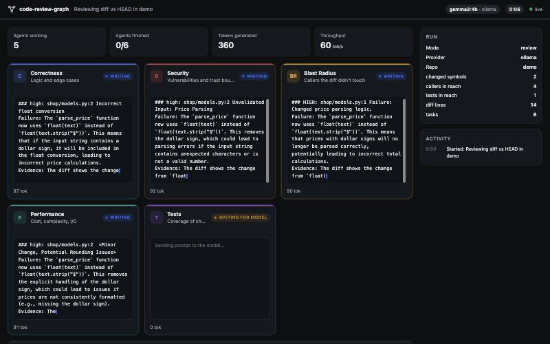

# code-reviewer-graph

**Compile any codebase into a self-updating knowledge graph, then review pull requests with a team of local AI agents that can see the blast radius. Free, private, and live on screen.**



Most AI code review tools paste a diff into a model and hope. The model never sees the callers three files away, doesn't know the module broke the same way last month, and forgets everything when the review ends.

`code-reviewer-graph` (`crg`) follows Andrej Karpathy's *LLM wiki* idea: **compile knowledge once, keep it current, and query it.** It builds a persistent graph of your code in any language. Agents write an interlinked wiki on top of it, and each review gets only the subgraph a change actually touches. Reviews write back what they learn, so review #500 knows things review #1 didn't.

By default every agent runs **locally through Ollama**: no API key, no cost, and no code leaves your machine.

```
             ┌──────────────── exact layer (tree-sitter, no LLM) ────────────────┐
  source ──▶ │ nodes: modules, classes, functions, methods     300+ languages    │
             │ edges: calls · imports · contains   (+ confidence on every edge) │
             └───────────────────────────────┬───────────────────────────────────┘
                                             │ clusters (label propagation)
             ┌───────────────────────────────▼──── meaning layer (local agents) ──┐
             │ librarian agents write module + cluster pages, [[backlinks]]       │
             │ from the graph, notes written back by past reviews                 │
             └───────────────────────────────┬───────────────────────────────────┘
                                             │
  PR diff ──▶ changed nodes ──▶ callers + tests in reach ──▶ wiki pages ──┐
                                                                          ▼
      ┌─────────────┬──────────┬──────────────┬─────────────┬─────────┐
      │ Correctness │ Security │ Blast Radius │ Performance │  Tests  │  specialists, in parallel
      └──────┬──────┴────┬─────┴──────┬───────┴──────┬──────┴────┬────┘
             └───────────┴── consensus by location ──┴───────────┘
                                      ▼
                             Judge ──▶ final review ──▶ learnings written back to the graph
```

## Quickstart (free, local)

```bash
# 1. a local model runtime
brew install ollama            # or see ollama.com for Linux/Windows
OLLAMA_NUM_PARALLEL=4 ollama serve
ollama pull qwen2.5-coder:7b   # any chat model works; bigger = better reviews

# 2. crg
pip install git+https://github.com/tedevH/code-reviewer-graph

# 3. in your repo
crg index                          # parse into the graph: seconds, no LLM
crg compile --ui                   # librarian agents write the wiki, live on screen
crg review --diff main --ui --learn  # 5 specialists + judge review your branch
```

`--ui` opens the dashboard at `http://127.0.0.1:8765`. Every agent gets a card showing its status (queued, waiting for model, thinking, writing, done), its live token stream, tokens/sec and elapsed time. A run panel and an activity log sit beside the cards, and the final review appears when the judge finishes. The server binds to localhost only.

## The agents

| Agent | Looks for |
|---|---|
| **Correctness** | logic errors, edge cases, null/empty handling, error paths, concurrency |
| **Security** | injection, authn/authz gaps, secrets, unsafe deserialization, path traversal, SSRF |
| **Blast Radius** | callers the diff didn't touch that now break (signature, return value, invariant) |
| **Performance** | algorithmic blowups, N+1 queries, blocking I/O on hot paths, unbounded memory |
| **Tests** | changed behaviour no test reaches, tests the diff makes wrong |
| **Judge** | checks every finding against the diff, drops speculation, merges duplicates, writes the review |
| **Librarians** | a pool of workers that write wiki pages for modules in parallel (`compile`) |

Small local models are much better at one narrow question than at "review this", so each specialist gets one job. Before the judge runs, crg groups the specialists' findings by file and line and tells the judge how many agents flagged each spot independently. That is a deterministic consensus signal that helps a small judge separate real bugs from noise.

**Tested on a MacBook (M5, 24 GB) with `gemma3:4b`:** on a diff with two planted bugs, all five specialists flagged the broken `parse_price` (5/5 consensus) and three flagged the broken discount math. The full review took about 45 seconds and cost nothing. A 4B judge still lets some duplicates through. Use a 7–14B coder model, or give the judge a bigger one:

```bash
crg review --diff main --model qwen2.5-coder:7b --judge-model qwen2.5-coder:14b --ui
```

### Model providers

| `--provider` | What | Notes |
|---|---|---|
| `ollama` (default) | local models via [Ollama](https://ollama.com) | Picks your first installed model if `--model` isn't given. Set `OLLAMA_NUM_PARALLEL` so agents truly run at once. |
| `openai` | any OpenAI-compatible local server: LM Studio, llama.cpp `llama-server`, vLLM, LocalAI | `--base-url http://localhost:1234/v1` |
| `anthropic` | Claude via the Anthropic API | Paid; `crg compile` asks before spending. Needs `ANTHROPIC_API_KEY` or `ant auth login`. |

Environment overrides: `CRG_PROVIDER`, `CRG_MODEL`, `CRG_BASE_URL`, `CRG_NUM_CTX` (Ollama context window, default 16384; Ollama silently truncates prompts beyond it), `OLLAMA_HOST`.

## Languages

Every language [tree-sitter-language-pack](https://github.com/Goldziher/tree-sitter-language-pack) can parse (300+). Grammars download on first use and are cached.

| Tier | Languages | What you get |
|---|---|---|
| **Deep** | Python | dedicated extractor: packages, relative imports, re-exports |
| **Tested end to end** | TypeScript, JavaScript, Go, Java, Rust, C, C++, Ruby, PHP | cross-file call resolution through each language's import system (fixture tests in `tests/fixtures/poly/`) |
| **Tags-query** | ~70 more with a `tags.scm` (C#, Kotlin, Swift, Scala, Dart, Elixir, Lua, OCaml, Solidity, …) | precise definitions; calls via the shared walker; imports via path-suffix matching |
| **Heuristic** | everything else (Zig, Haskell, Julia, Nim, …) | definitions and calls from node-type heuristics |

How imports become file edges:
- **JS/TS:** relative paths, `index` files, ESM `./x.js` → `x.ts`, `@/` aliases. npm packages are skipped.
- **Go:** module path from `go.mod`; same-package files are visible unqualified.
- **C/C++:** `#include` resolves relative first, and a call through `util.h` links to the definition in `util.c`.
- **Java, Kotlin, PHP, Rust, C#, Dart:** path-suffix matching that tolerates roots like `src/main/java/` or PSR-4's `App\` → `src/`.

Every call edge is labeled with how it was resolved:
- `exact`: through scope, imports, `self`/`this`, the enclosing class, or the same package
- `name`: exactly one definition in the repo has that name
- `ambiguous`: 2–3 candidates, each linked and flagged "verify"

Calls into stdlib or third-party code produce no edges.

Speed: [click](https://github.com/pallets/click) (Python, 91 files), [cobra](https://github.com/spf13/cobra) (Go) and [ky](https://github.com/sindresorhus/ky) (TypeScript, 98 files) each index in about 1–1.5 seconds.

## Commands

| Command | What it does | LLM? |
|---|---|---|
| `crg index` | Parse the repo into nodes and edges, detect clusters, render wiki skeleton | no |
| `crg impact <symbol>…` | Callers by hop, tests that reach the symbol, affected wiki pages | no |
| `crg impact --diff REF` | Same, starting from the functions a `git diff REF` touches (`--diff-file -` reads stdin) | no |
| `crg compile [--workers N] [--ui]` | Librarian agents write pages for stale modules and clusters (incremental by file hash) | yes |
| `crg review --diff REF [--ui] [--learn]` | Specialists + judge review the diff with graph and wiki context | yes |
| `crg wiki` | Re-render the wiki from the store | no |
| `crg learn <target> "<fact>"` | Attach a durable note to a module or symbol | no |
| `crg stats` | Graph size, clusters, stale modules | no |

Useful flags: `--agents security,correctness` runs a subset of specialists, `--depth N` sets caller hops, `--workers N` sets parallel agents, and `--port` / `--no-open` control the dashboard.

Everything lives in `.crg/`: `graph.db` (SQLite) and `wiki/` (markdown, Obsidian-compatible). Ignore `graph.db` in git. Commit `wiki/` if you want the team to share the compiled knowledge.

### Example: `crg impact` on click

```
$ crg impact click.parser._unpack_args --depth 4

## Callers (blast radius)
### 1 hop
- `src/click/parser.py:316` method `_OptionParser._process_args_for_args` → calls `_unpack_args`
### 2 hops
- `src/click/parser.py:298` method `_OptionParser.parse_args` → calls `_OptionParser._process_args_for_args`
### 3 hops
- `src/click/core.py:1396` method `Command.parse_args` → calls `_OptionParser.parse_args` _(ambiguous, verify)_
...
## Tests that reach the change
- `tests/test_basic.py:131` function `test_return_values` → calls `Command.make_context` _(ambiguous, verify)_
```

## Using it in CI

```yaml
# .github/workflows/review.yml
on: pull_request
jobs:
  review:
    runs-on: ubuntu-latest
    permissions: { pull-requests: write, contents: read }
    steps:
      - uses: actions/checkout@v4
        with: { fetch-depth: 0 }
      - uses: actions/setup-python@v5
        with: { python-version: "3.12" }
      - run: pip install git+https://github.com/tedevH/code-reviewer-graph
      - run: crg index
      # Local models need a GPU runner; on hosted runners use the Claude provider.
      - run: crg review --provider anthropic --diff origin/${{ github.base_ref }} > review.md
        env: { ANTHROPIC_API_KEY: "${{ secrets.ANTHROPIC_API_KEY }}" }
      - run: gh pr comment ${{ github.event.number }} --body-file review.md
        env: { GH_TOKEN: "${{ github.token }}" }
```

Cache `.crg/` between runs (`actions/cache`) so `compile` only re-summarizes changed modules.

## Limitations

- Static resolution can't see dynamic dispatch, monkey-patching or callbacks passed as values. Those show up as missing or `ambiguous` edges, never as false `exact` ones.
- Outside the tested languages, import resolution is best-effort, so expect more `name`/`ambiguous` edges.
- Review quality tracks model size. A 4B model finds real bugs but writes a noisier final review than a 14B model or Claude.
- Files over 1 MB are skipped by `index`, and over 200 KB by `compile`, rather than silently truncated.

## Roadmap

- [ ] Git-history edges (`modified_in`, `fixed_bug`) so agents know which code has broken before
- [ ] Eval harness: replay historical bug-introducing PRs and measure each agent's precision/recall
- [ ] Graph view in the dashboard (the impact subgraph, lit up as agents cite it)
- [ ] MCP server so coding agents can query the graph directly
- [ ] GitHub App with inline comments

## Contributing

```bash
git clone https://github.com/tedevH/code-reviewer-graph && cd code-reviewer-graph
python -m venv .venv && . .venv/bin/activate
pip install -e ".[dev]"
pytest
```

The tests never call a model: agents run against scripted fakes, including one that proves the specialists execute concurrently. Language tests download tree-sitter grammars on first run.

## License

MIT
